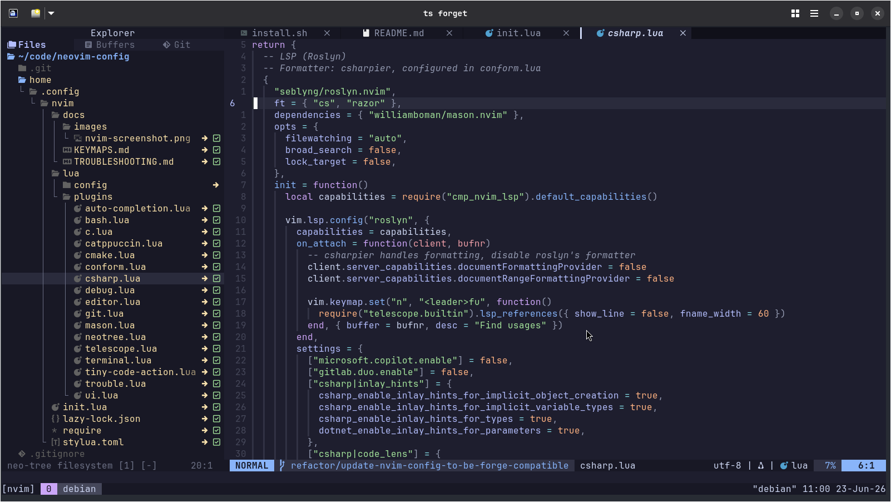

# forge-nvim

Personal Neovim config. Part of the [forge](https://github.com/clintonbampoe/forge) ecosystem.



Built on [lazy.nvim](https://github.com/folke/lazy.nvim): every plugin area is one file under `lua/plugins/`, and a language gets its own file when it needs something beyond an LSP server and a formatter.

## What's inside

- **Looks** — catppuccin colorscheme (rose-pine, tokyonight and kanagawa are installed too), lualine statusline, indent guides
- **Editing** — treesitter highlighting, code folding, autopairs, auto-save, format on save, completion with snippets
- **Navigation** — telescope (files, grep, buffers, help), neo-tree file explorer, trouble diagnostics list
- **Git** — gitsigns in the gutter, lazygit in a floating window
- **Tools** — mason installs LSP servers, formatters and debug adapters automatically on first launch
- **Languages** — Bash, C, C++, CMake, C#, Go, Lua, Markdown, Nginx, TypeScript/JavaScript, XML, YAML

## Layout

```
init.lua                  # options, global keymaps, diagnostics
lua/
  config/
    lazy.lua              # lazy.nvim bootstrap + colorscheme choice (don't touch)
  plugins/
    ui.lua                # lualine, indent guides, column guides
    colorscheme.lua       # catppuccin, rose-pine, tokyonight, kanagawa
    editor.lua            # autopairs, auto-save, matchup, treesitter, folding
    auto-completion.lua   # nvim-cmp + LuaSnip
    telescope.lua         # fuzzy finder
    neotree.lua           # file explorer
    git.lua               # gitsigns + lazygit
    terminal.lua          # floating terminal (toggleterm)
    trouble.lua           # diagnostics list
    sessions.lua          # saves and restores a session per project directory
    markdown.lua          # renders markdown inside the buffer
    mason.lua             # tool installer + the auto-install list
    conform.lua           # format on save, formatter per filetype
    lsp.lua               # all LSP servers + LSP keymaps
    tiny-code-action.lua  # code action picker
    c.lua                 # clangd extensions + CodeLLDB debug adapter
    csharp.lua            # roslyn.nvim + find-usages keymap
    go.lua                # :GoFmt, :GoImports, :GoLint, :GoVet, :GoRun
    bash.lua, cmake.lua, nginx.lua,
    typescript.lua, xml.lua, yaml.lua   # empty stubs — config for these lives in lsp.lua/conform.lua
docs/
  KEYMAPS.md              # every keybinding
  TROUBLESHOOTING.md      # common problems and their fixes
lazy-lock.json            # pinned plugin versions (commit this)
stylua.toml               # formatting rules for this config itself
```

## Setup

You need:

- Neovim **0.11+** (check with `nvim --version`)
- System tools: `git gcc make ripgrep curl unzip nodejs npm`
- A [Nerd Font](https://www.nerdfonts.com/) selected in your terminal (for icons)
- [lazygit](https://github.com/jesseduffield/lazygit/releases) on your PATH
- A clipboard helper: `xclip` (X11) or `wl-clipboard` (Wayland)
- For C# only: [.NET SDK 8](https://learn.microsoft.com/en-us/dotnet/core/install/linux)

```bash
sudo apt install git gcc make ripgrep curl unzip nodejs npm xclip
```

**With forge** — add this line to `configs.conf` in your forge repo, then run forge:

```
nvim|https://github.com/clintonbampoe/forge-nvim.git|forge-nvim
```

**Manually:**

```bash
git clone https://github.com/clintonbampoe/forge-nvim.git ~/.config/nvim
nvim --headless "+Lazy! sync" +qa   # install all plugins
nvim                                # Mason installs the tools on first launch
```

## Adding a language

Four shared files hold most of it; a fifth file is optional.

1. **LSP server** — add a `vim.lsp.config(...)` block plus `vim.lsp.enable(...)` in `lua/plugins/lsp.lua`
2. **Tools** — add the server and formatter names to `ensure_installed` in `lua/plugins/mason.lua`
3. **Formatter** — add `filetype = { 'formatter' }` to `formatters_by_ft` in `lua/plugins/conform.lua`
4. **Highlighting** — add the parser name to the `install({...})` list in `lua/plugins/editor.lua`
5. **Extras (optional)** — create `lua/plugins/<language>.lua` for anything language-specific: plugins, debug adapters, custom commands. See `c.lua`, `csharp.lua` and `go.lua` for examples.

lazy.nvim picks up new files automatically — no registration needed. If you add keymaps, add a row to `docs/KEYMAPS.md` too.

## Docs

- [docs/KEYMAPS.md](docs/KEYMAPS.md) — every keybinding, grouped by the file that defines it
- [docs/TROUBLESHOOTING.md](docs/TROUBLESHOOTING.md) — common problems, one section per fix
